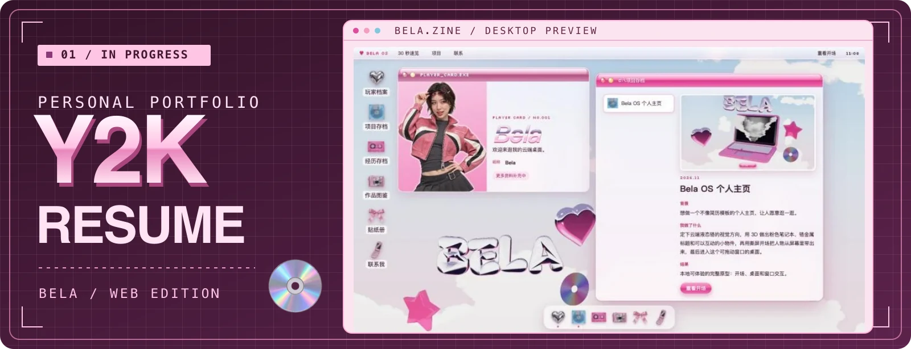
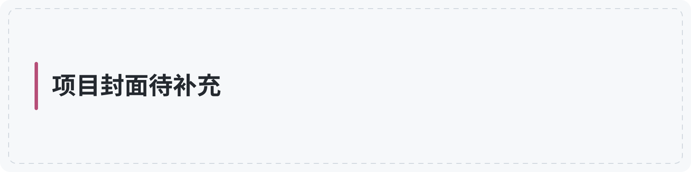
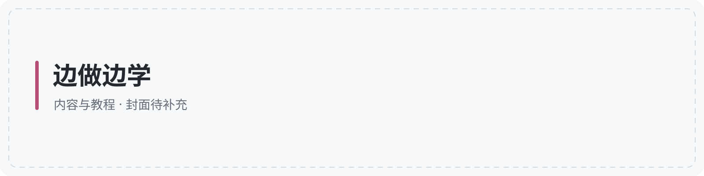

<!-- 首页内容在这个文件中维护；使用方法见 MAINTENANCE.md。 -->
<!-- 可选：重要项目推广区可放在个人横幅之前。 -->

## 自媒体账号

<!-- ACCOUNTS-START -->

💬 **微信号：belaleeAI**，扫码添加朋友。视频号二维码待补充。

[📕 小红书：李贝拉Bela](https://www.xiaohongshu.com/user/profile/6a1f9a8b0000000008009003) · [⚡ 即刻：李贝拉Bela](https://m.okjike.com/users/FBA3136A-3617-4298-BB69-5F24833BEE35)

[🐦 X：@belalee_ai](https://x.com/belalee_ai) · [🚀 更多开源项目 →](https://github.com/belalee-ai?tab=repositories)
<!-- ACCOUNTS-END -->

<!-- STATS-START -->

<!-- STATS-END -->

## 最近在做

**Y2K 风格个人简历网站**

我想把简历做成一份可以逛的电子杂志。打开网站，从复古电脑桌面进入，用粉色窗口翻看我的经历、作品和联系方式。现在正在打磨撕纸拼贴、数码贴纸和页面转场，让每个章节都像杂志里的一页。

[💿 逛逛我的简历网站 →](https://belalee-website.vercel.app/) · [查看项目源码](https://github.com/belalee-ai/belalee-website)

## Skills

## DSH 插件

## 动效库

## 自动剪辑工作流

## 边做边学

内容介绍与链接待补充。
