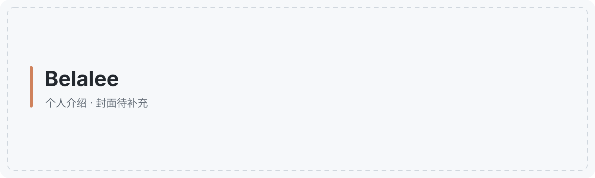
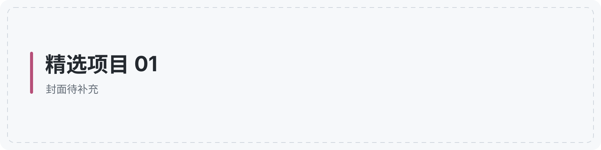
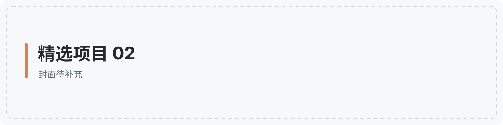
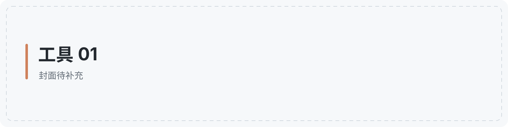
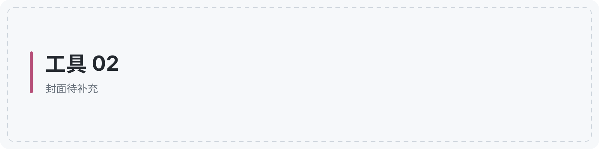
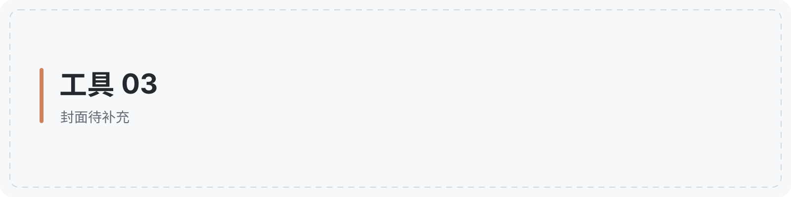
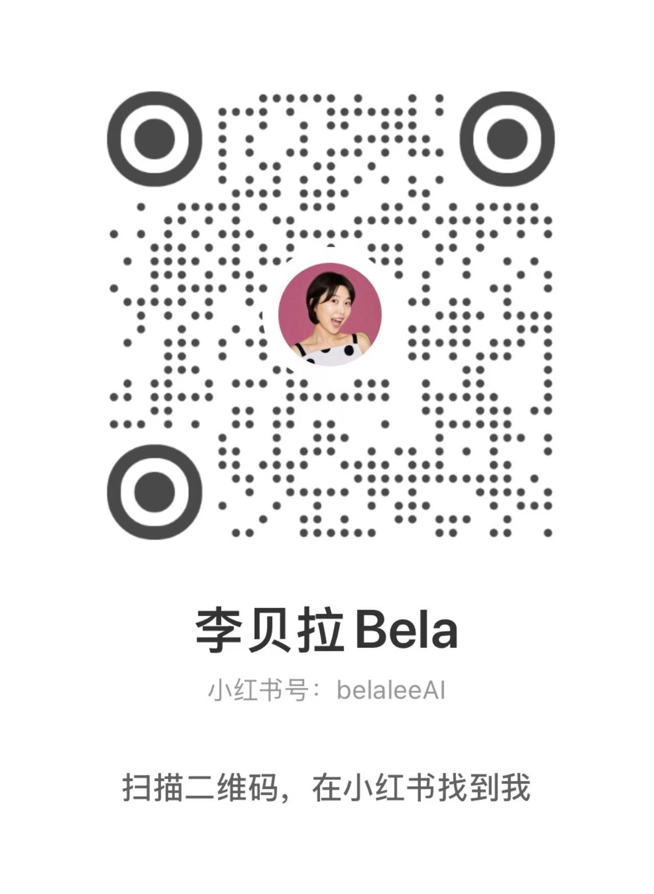

<!-- 首页内容在这个文件中维护；使用方法见 MAINTENANCE.md。 -->
<!-- 可选：重要项目推广区可放在个人横幅之前。 -->

我是 **Belalee**。个人简介待补充。

<!-- STATS-START -->

<!-- STATS-END -->

## 最近在做

**近期项目名称待补充**

项目介绍待补充。

<!-- 添加链接示例：[查看项目 →](https://github.com/belalee-ai/你的仓库名) -->

## 从这里开始

**精选项目 01** · 项目介绍与链接待补充。

**精选项目 02** · 项目介绍与链接待补充。

**精选项目 03** · 项目介绍与链接待补充。

## 给 Agent 配上工具

**工具 01** · 工具介绍与链接待补充。

**工具 02** · 工具介绍与链接待补充。

**工具 03** · 工具介绍与链接待补充。

## 边做边学

内容介绍与链接待补充。

## 在这些平台找到我

<!-- ACCOUNTS-START -->
点击平台名称打开主页，或扫描二维码找到我。

<table>
  <tr>
    <td align="center" valign="top" width="50%">
      <strong><a href="https://www.xiaohongshu.com/user/profile/6a1f9a8b0000000008009003">小红书 · 李贝拉Bela</a></strong> 
      小红书号：belaleeAI  
      
    </td>
    <td align="center" valign="top" width="50%">
      <strong>公众号 · 李贝拉Bela</strong> 
      微信搜一搜「李贝拉Bela」  
      
    </td>
  </tr>
  <tr>
    <td align="center" valign="top">
      <strong>视频号</strong> 
      账号及二维码待补充  
      
    </td>
    <td align="center" valign="top">
      <strong>微信 · 李贝拉Bela</strong> 
      微信号：belaleeAI  
      
    </td>
  </tr>
  <tr>
    <td align="center" valign="top">
      <strong><a href="https://x.com/belalee_ai">X · 李贝拉Bela</a></strong> 
      @belalee_ai  
      
    </td>
    <td align="center" valign="top">
      <strong><a href="https://m.okjike.com/users/FBA3136A-3617-4298-BB69-5F24833BEE35">即刻 · 李贝拉Bela</a></strong> 
      点击主页或扫码关注  
      
    </td>
  </tr>
  <tr>
    <td align="center" colspan="2">
      <strong><a href="https://github.com/belalee-ai">GitHub · belalee-ai</a></strong> 
      开源项目持续更新  
      
    </td>
  </tr>
</table>
<!-- ACCOUNTS-END -->

---

[更多开源项目 →](https://github.com/belalee-ai?tab=repositories)
